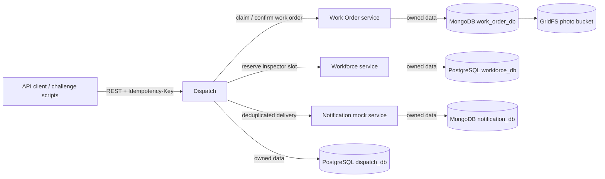
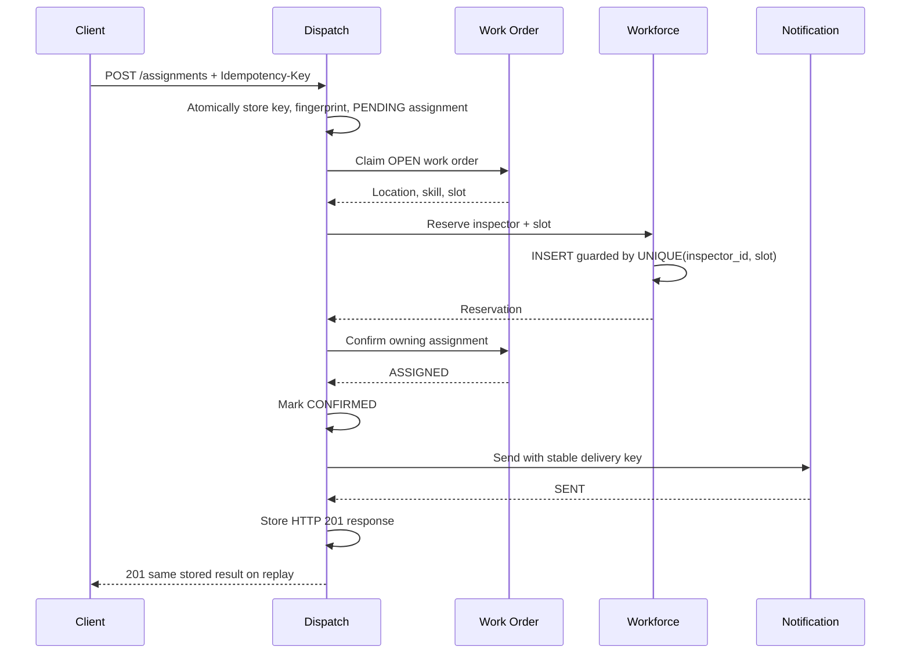
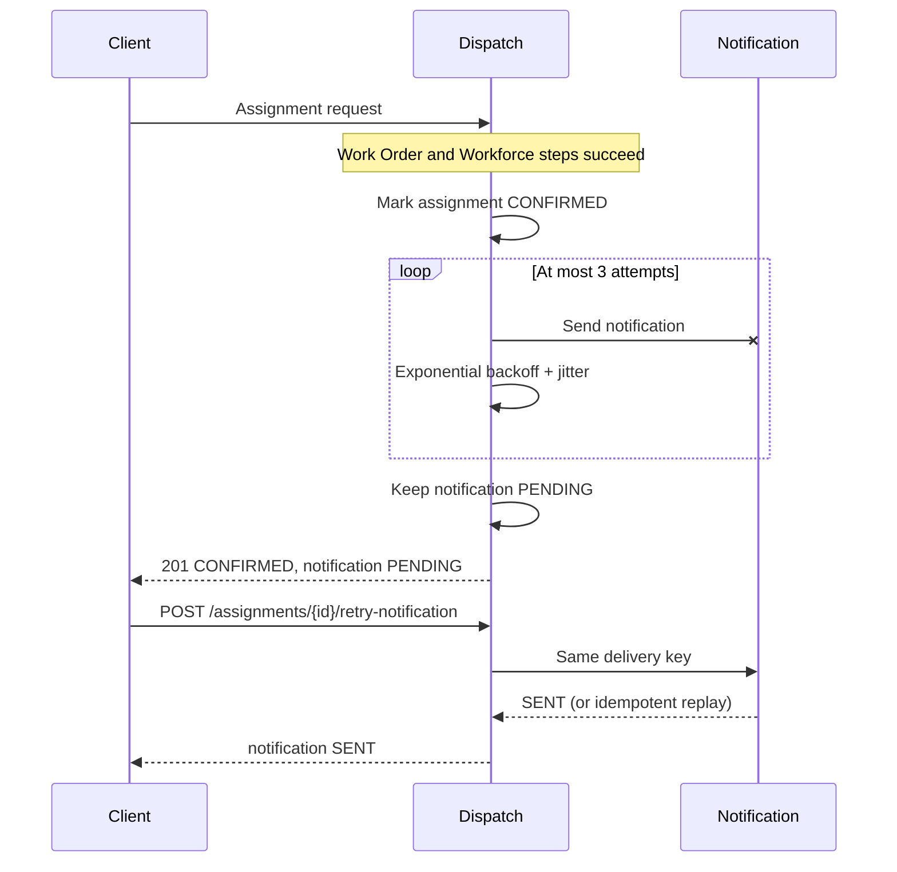
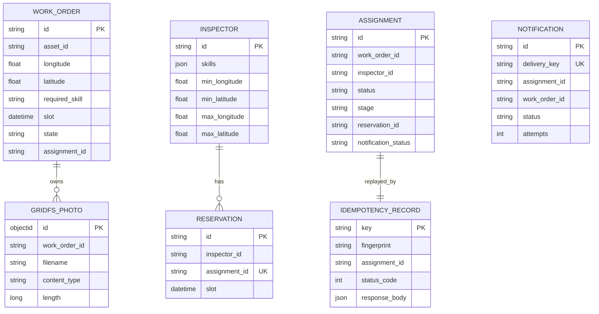

# GeoInspect architecture

This is the proposed design adapted from the GeoInspect reference project.
Group 14's implementations and verification evidence will be delivered on the
member branches described in [TEAM.md](../TEAM.md).

## Component view

All arrows between services are HTTP. No service reads another service's database. `X-Correlation-ID` is copied along the full request path.

## Happy-path sequence

## Failure path: notification unavailable

Notification is an after-commit side effect. Its failure does not undo operational work. A delivery committed before a lost response is repeated with the same delivery key and produces one record.

## Data ownership

These are separate service-owned models rather than one cross-service ER schema. IDs from other services are references only and have no database foreign keys.
